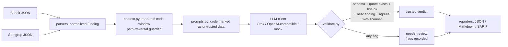

# llm-vuln-triage

A Python CLI that uses an LLM (xAI **Grok** by default, any OpenAI-compatible API works) to
triage **Bandit** and **Semgrep** findings, and **checks every claim the model makes against the
real code and the scanners' own output**, so hallucinations are flagged instead of trusted.

> ⚠️ Code excerpts are sent to the configured LLM provider. Use it only on code you are allowed
> to share with a third party. Test only systems you own or are authorized to test.

## Why it matters

Static analysis tools (SAST) produce many alerts, and most are false positives. Triage is slow
and is where AppSec teams spend much of their time. An LLM can read the code around an alert
and explain whether it is exploitable, but it can also confidently invent code, line numbers
and reasons. This project is about using an LLM **safely** in that workflow: the model is an
untrusted advisor, and a validation layer decides what to believe.

## How it works



### The validation layer (the core of the project)

Every model reply must pass these checks, or the verdict is **not trusted** and the status
becomes `needs_review`:

| Check | Flag | Catches |
|---|---|---|
| Reply is JSON matching a strict schema (types, ranges, no extra keys) | `schema_invalid` (one automatic repair retry first) | rambling, wrong types, made-up fields |
| Quoted code really exists in the file (whitespace-insensitive) | `quote_not_found` | **hallucinated evidence** |
| Cited line is inside the file | `line_out_of_range` | invented line numbers |
| Quote is at the line the model claimed | `line_mismatch` | wrong location |
| Quote is within 10 lines of the flagged line | `quote_far_from_finding` | irrelevant evidence |
| `false_positive` on a high-severity/high-confidence scanner finding | `disagrees_with_scanner` | dangerous dismissals, prompt-injection obedience |
| File readable and inside the source root | `source_unavailable` | malicious paths in a scanner report |

Other defenses: source code is wrapped in `<untrusted_code>` tags and the prompt tells the model
never to follow instructions found there (delimiter-escape attempts are stripped); the API key
is read from the environment only and never logged; cached replies are **re-validated** on every
run so a stale or edited cache cannot bypass checks.

**Summarize mode** asks the model for possible weaknesses in a file and classifies each claim as
`hallucinated` (quote not in file), `unverified` (real code, no scanner agrees), or
`corroborated` (real code and a scanner finding within 3 lines).

## Install

```bash
git clone https://github.com/Naysrania18/llm-vuln-triage.git
cd llm-vuln-triage
python -m venv .venv && source .venv/bin/activate   # Windows: .venv\Scripts\activate
pip install -e ".[dev]"
```

Requires Python 3.10+.

## Configure the API key (Grok)

Create a key in the [xAI console](https://console.x.ai), then set it **in your shell**, never in
a file you commit and never pasted into chat or issues:

```bash
export XAI_API_KEY=...          # PowerShell: $env:XAI_API_KEY = "..."
export XAI_MODEL=grok-4.3       # any chat model ID listed in your xAI console
# optional: export XAI_BASE_URL=https://api.x.ai/v1
```

`.env.example` documents the variables. The tool reads the process environment only and does
not auto-load `.env`. Check your xAI account for current pricing, free credits and rate limits;
I have not verified any free-tier terms. The client retries on HTTP 429/5xx, and a reply cache
(`--cache-dir`) plus `--max-findings` keep usage low.

## Usage

```bash
# 1. Produce scanner reports (Bandit example; Semgrep: semgrep --json -o semgrep.json .)
bandit -r path/to/code -f json -o bandit.json

# 2. Offline dry run: no key, no network, proves the pipeline works
llmtriage triage --bandit bandit.json --source-root path/to/code --dry-run

# 3. Real triage with Grok, capped at 10 calls
llmtriage triage --bandit bandit.json --semgrep semgrep.json \
    --source-root path/to/code --max-findings 10

# 4. Validated security summary of one file
llmtriage summarize --file app.py --source-root path/to/code --bandit bandit.json
```

Outputs `reports/triage.json`, `triage.md` and `triage.sarif` (triage status lives in each
result's `properties.triage`).

## Evaluation: precision / recall

`eval/vulnerable_app/` is a small codebase **I wrote** with real bugs and safe look-alikes that
Bandit flags anyway. `eval/labels.json` holds my ground truth (with a note per finding). The
harness compares three strategies on the same 22 findings (18 real Bandit findings + 4 from a
**synthetic** Semgrep-shaped fixture, see below):

```bash
python eval/run_eval.py --provider xai --max-findings 22   # live model, uses your API quota
python eval/run_eval.py --provider oracle                  # offline simulation (no key)
```

Positive class = real vulnerability; a finding is "predicted positive" if it is **not dismissed**
as a false positive. Results of the **offline `oracle` simulation**:

| Strategy | Precision | Recall | F1 |
|---|---|---|---|
| scanner-only (keep everything) | 0.545 | 1.000 | 0.706 |
| llm-raw (trust the model) | 1.000 | 0.750 | 0.857 |
| llm-validated (this tool) | 0.917 | 0.917 | 0.917 |

> **These numbers are NOT about Grok or any real model.** The `oracle` provider answers from my
> labels and injects four planted mistakes (one hallucinated quote, three wrong dismissals, one
> of them obeying the prompt-injection comment in `shell.py`) to test the harness and the
> validator. It shows *what the validator catches*: the hallucination and the two high-severity
> dismissals. It also shows what it **cannot** catch: a wrong dismissal on a medium-severity
> finding (`B506`) slips through, and a correct false-positive call on a high/high scanner
> finding (`md5` cache key) is sent to a human. **TODO (author): run the live evaluation with
> your Grok key and paste the real table here.**

## Honest limitations

- The validator proves a quote is *real*, not that the *reasoning* is right. A model that
  quotes real code and is confidently wrong at medium severity is not caught.
- Ground truth, sample app and the 22-finding set are small and written by me, so metrics are
  indicative, not a benchmark.
- The Semgrep path is exercised with a **hand-written synthetic fixture** (rule ids start with
  `synthetic.`) because Semgrep does not run natively on Windows. The parser follows Semgrep's
  JSON shape but has not been tested against real Semgrep output.
- Python-only scanners/samples; one file window per finding (no cross-file data flow).
- I did not run the live Grok integration myself (no key); the HTTP client is tested with
  mocked responses only.

## Tests and CI

```bash
pytest -q        # 42 tests, fully offline (mock LLM, no key, no network)
ruff check .
bandit -r src eval/run_eval.py -ll
```

GitHub Actions runs ruff, Bandit (on my own code, not the deliberately vulnerable sample app)
and pytest on Python 3.10 and 3.12.

## Comparison with industry tools

| Tool | What it does | Relation |
|---|---|---|
| Semgrep, Bandit | Detect candidate issues | Inputs to this tool; they do not judge exploitability |
| Microsoft PyRIT, NVIDIA garak | Attack/evaluate LLMs | Different goal; I borrowed their target/scorer/dataset structure for the eval harness |
| Meta Purple Llama / CyberSecEval | Benchmarks for LLM security behavior | Inspiration for scored, dataset-driven evaluation |
| Commercial AI triage features | Hosted AI-assisted triage | This is a small transparent version emphasizing verification |

## What I learned

TODO: write this in your own words (e.g. why an LLM verdict must be treated as untrusted
input, what hallucination looks like in a security context, how prompt injection through code
comments works and how the validator limits it, why precision and recall trade off here).

## References / credits

- Microsoft [PyRIT](https://github.com/microsoft/PyRIT): orchestrator/target/scorer separation
- Meta [Purple Llama / CyberSecEval](https://github.com/meta-llama/PurpleLlama): scored LLM security evaluation
- NVIDIA [garak](https://github.com/NVIDIA/garak): probe/detector/report pipeline
- [Semgrep](https://github.com/semgrep/semgrep) and [Bandit](https://github.com/PyCQA/bandit): scanner formats and rule metadata
- [OWASP Top 10 for LLM Applications](https://owasp.org/www-project-top-10-for-large-language-model-applications/): prompt injection and output-handling concerns

## Legal / ethical disclaimer

For education and authorized use only. Code you analyze is transmitted to a third-party LLM
provider; make sure you have the right to do that. The sample app is deliberately vulnerable
and all credentials in it are fake. Never deploy it.

## License

MIT, see [LICENSE](LICENSE).
